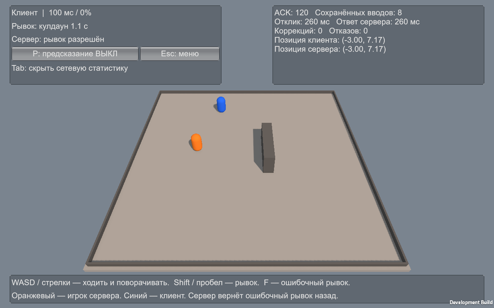
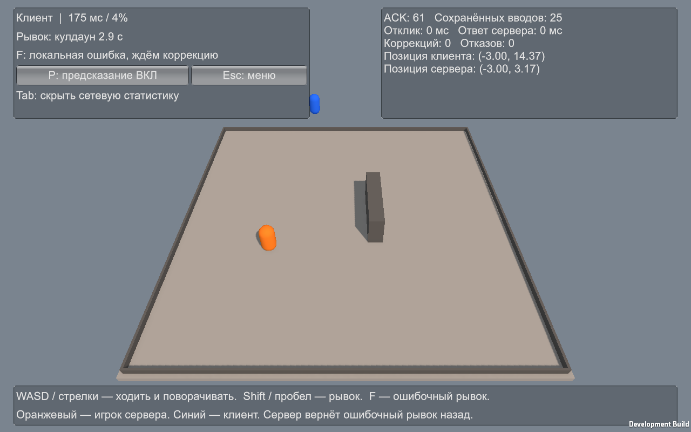
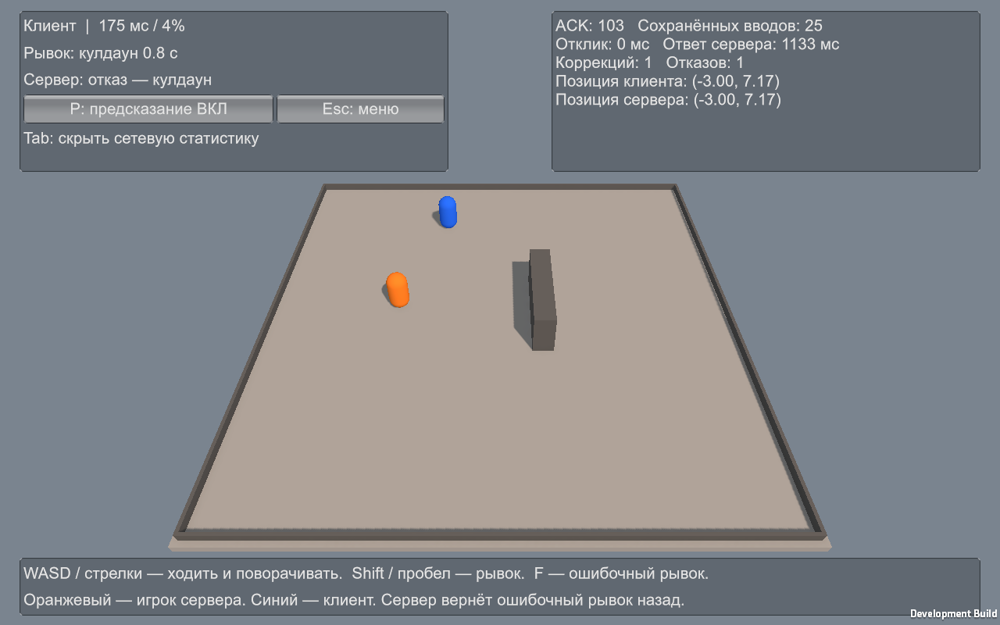

# Подписанные снимки упрощённой демонстрации

Снимки получены из реальных Host/Client-процессов. В каждом сценарии клиент идёт вперёд, затем делает рывок. В сценарии коррекции дополнительно выполняется неверный рывок F.

## Без CSP: 100 мс / 0%

Действие показано после серверного ответа. Отклик и ответ сервера почти совпадают.

## С CSP: 100 мс / 0%

Локальный отклик быстрый, серверное подтверждение приходит позже. Сравни числа в статистике.

## Ошибочное предсказание: 175 мс / 4%, до коррекции

После F локальная позиция отличается от серверной. Ошибочный рывок выполняется во время кулдауна.

## Серверная коррекция: 175 мс / 4%, после ACK

Сервер отказал по кулдауну. Есть коррекция и отказ, позиции снова совпадают.

Все исходные CSV, PNG и результаты: [media/checks](../../media/checks/). Числа: [матрица](../Prediction_Test_Matrix.md). Замеры на снимках коррекции относятся к последнему действию; в матрице — к первому разрешённому рывку.
